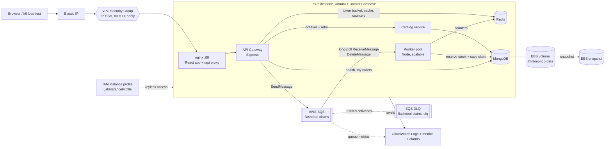
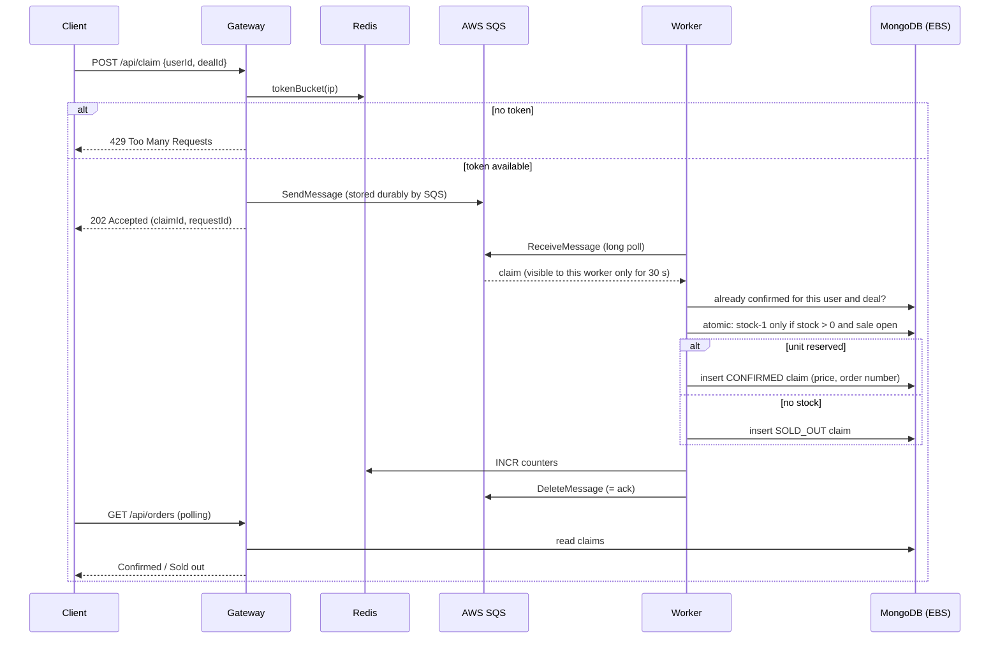
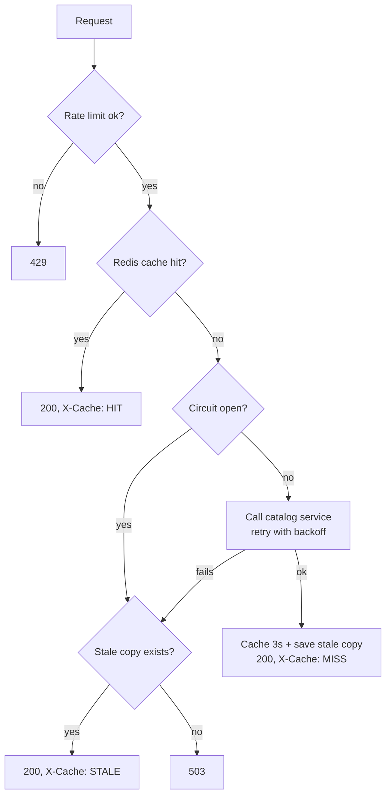

# Architecture and data flow (AWS deployment)

Mermaid renders on GitHub and at https://mermaid.live (export PNG/SVG for the submission).

## AWS infrastructure



## Data flow: POST /api/claim



If the worker fails, it skips `DeleteMessage`: the message becomes visible again after a backoff, and after 3 failed
deliveries SQS moves it to the dead-letter queue.

## Data flow: GET /api/deals



## Request tracing

Every request gets a `requestId` (header `X-Request-Id`, also saved on the claim, shown in the order receipt and attached to the
SQS message as a message attribute). Each log line is JSON with `service`, `stage` and `requestId`:

`gateway` -> `rate-limiter` -> `gateway->queue` -> `queue->worker` -> `worker->mongodb`

On AWS, trace one request in **CloudWatch Logs Insights** (log group `/aws/ec2/flashdeal-logs`):

```
fields @timestamp, @logStream, @message
| filter @message like /<requestId>/
| sort @timestamp asc
```
