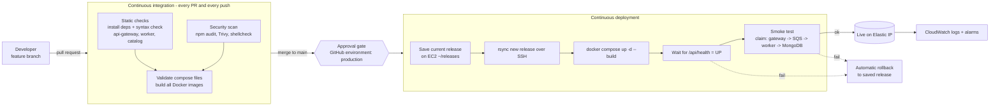

# CI/CD pipeline design

Tool: **GitHub Actions** (free, works with any cloud). Definition: `.github/workflows/ci-cd.yml`.
Target: the EC2 instance of the Learner Lab deployment (`docs/aws-deploy.md`).

## Pipeline overview



## Stages and quality gates

| Stage | What runs | Gate (pipeline fails if...) | Why |
|---|---|---|---|
| Static checks | `npm install` and `node --check` on every source file of gateway, worker and catalogue | dependency install or syntax error | catches broken code before it is built or deployed |
| Dependency audit | `npm audit --omit=dev --audit-level=critical` for every service | a CRITICAL vulnerability in a runtime dependency | supply-chain security |
| Trivy scan | filesystem scan: CVEs, committed secrets, Dockerfile / compose misconfigurations | report only (set `exit-code: '1'` to block on HIGH) | visible security posture without blocking the demo |
| Shell lint | `shellcheck` on `aws/*.sh`, `scripts/*.sh` | an error-level finding | the infrastructure scripts are code too |
| Build | `docker compose config` for both compose files, `docker compose build` for all 6 images | invalid compose file or failing image build | broken images never reach EC2 |
| Deploy | backup, rsync, `docker compose up -d --build` | SSH / build error on the server | |
| Health gate | polls `/api/health` for up to 150 s, requires `status == UP` (Redis, MongoDB, SQS, catalogue) | not healthy in time | the release must actually run |
| Smoke test | `scripts/smoke-test.sh`: health, catalogue, `POST /api/claim` returns 202, then the claim shows up as a stored order | any step fails | proves the whole path including SQS and the worker |
| Rollback | restores the saved release and restarts it | runs automatically when any deploy step fails | limits downtime of a bad release |

## Branching and release flow

1. Work on a feature branch, open a **pull request** to `main`: tests, scans and the image build run; nothing is deployed.
2. Merge to `main` (needs a green PR): the same checks run again, then the **deploy** job starts.
3. Optional approval gate: GitHub > Settings > Environments > `production` > *Required reviewers*. The deploy waits until a reviewer approves.
4. `workflow_dispatch` lets you re-run the pipeline (and re-deploy) from the Actions tab without a new commit.
5. Rollback by pipeline: automatic on failure. Manual rollback to an older version: revert the commit on `main` (the pipeline redeploys it), or on the server `tar xzf ~/releases/<file>.tgz` in `~/flashdeal-cc` and `docker compose up -d --build`. The last 3 releases are kept.

## Secrets and access

| Secret (GitHub > Settings > Secrets and variables > Actions) | Content |
|---|---|
| `EC2_HOST` | the Elastic IP |
| `EC2_USER` | `ubuntu` |
| `EC2_SSH_KEY` | the full text of `labsuser.pem` (private key) |

- There are **no AWS access keys** in the pipeline. The application's AWS access comes from the EC2 instance profile (`LabInstanceProfile`), the pipeline only needs SSH.
- `.env` (server-side settings) is never in git and is excluded from the rsync, so a deploy cannot overwrite it.
- Actions run with `permissions: contents: read` (least privilege for the `GITHUB_TOKEN`).
- Secrets are passed as environment variables (not interpolated into shell commands) to avoid script injection.

## One-time setup

1. Create a GitHub repository and push the project:
   ```bash
   cd flashdeal-cc
   git init && git add . && git commit -m "FlashDeal on AWS"
   git branch -M main
   git remote add origin https://github.com/<you>/flashdeal-cc.git
   git push -u origin main
   ```
2. Add the three secrets above. Create the environment `production` (optional: add yourself as required reviewer).
3. Security Group `flashdeal-sg`: GitHub-hosted runners have changing IP addresses, so the deploy job needs port **22 open to the internet**
   (`0.0.0.0/0`). Access is protected by key-only SSH, but this is the weakest point of the design (see `docs/security.md`). Safer alternatives:
   - open port 22 only while a deployment runs and close it afterwards, or
   - install a **self-hosted runner** on the EC2 instance (GitHub > Settings > Actions > Runners > New self-hosted runner), change `runs-on` of the
     deploy job to `[self-hosted, linux]`, and keep port 22 closed. The runner connects *out* to GitHub, nothing connects in.
4. Push a change to `main` and watch **Actions**. The first run proves the pipeline; afterwards every merge deploys itself.

> Learner Lab note: the instance must be **running** (lab started) for the deploy job to work. If the lab is stopped the deploy fails at the SSH step and nothing changes on the server.

## Why this design

- **GitHub Actions instead of AWS CodePipeline/CodeBuild/CodeDeploy:** works the same on any cloud, needs no IAM roles (Learner Lab does not let you create them), free for students, and the pipeline definition lives in the repository.
- **Build on the server (`docker compose up --build`) instead of a registry:** simplest for one host. The CI `build` job already proves that every image builds before anything is deployed.
- **Smoke test through the real queue:** the claim uses an unknown deal id, so it exercises gateway, SQS, worker and MongoDB (it is stored as `REJECTED / UNKNOWN_DEAL`) without changing any stock.

## Possible improvements (future work for the report)

- Build images once in CI and push them to **Amazon ECR**; deploy by image tag (immutable releases, faster rollback).
- **Staging environment** (second EC2 or compose project) and promote after a smoke test.
- **Blue/green or rolling deployment** behind an Application Load Balancer with two instances (zero downtime; today a deploy restarts containers for roughly 10-60 s).
- Infrastructure as Code (CloudFormation / Terraform) so the whole AWS setup is created by the pipeline too.
- Pin GitHub Actions to commit SHAs and enable Dependabot for npm and Actions updates.
